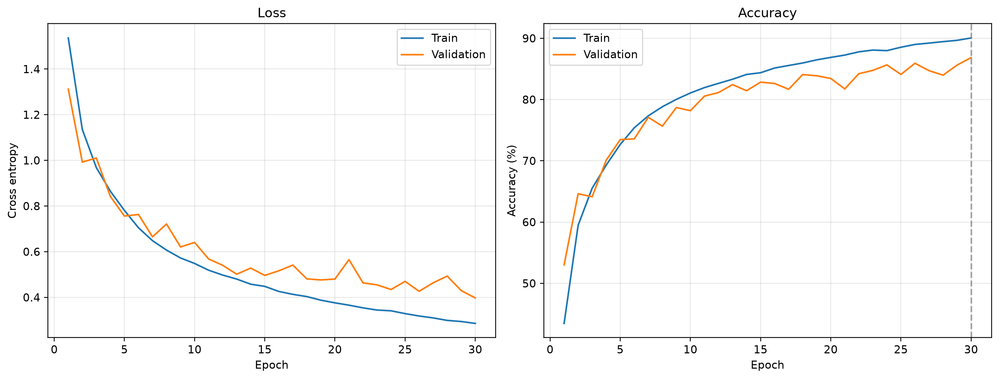
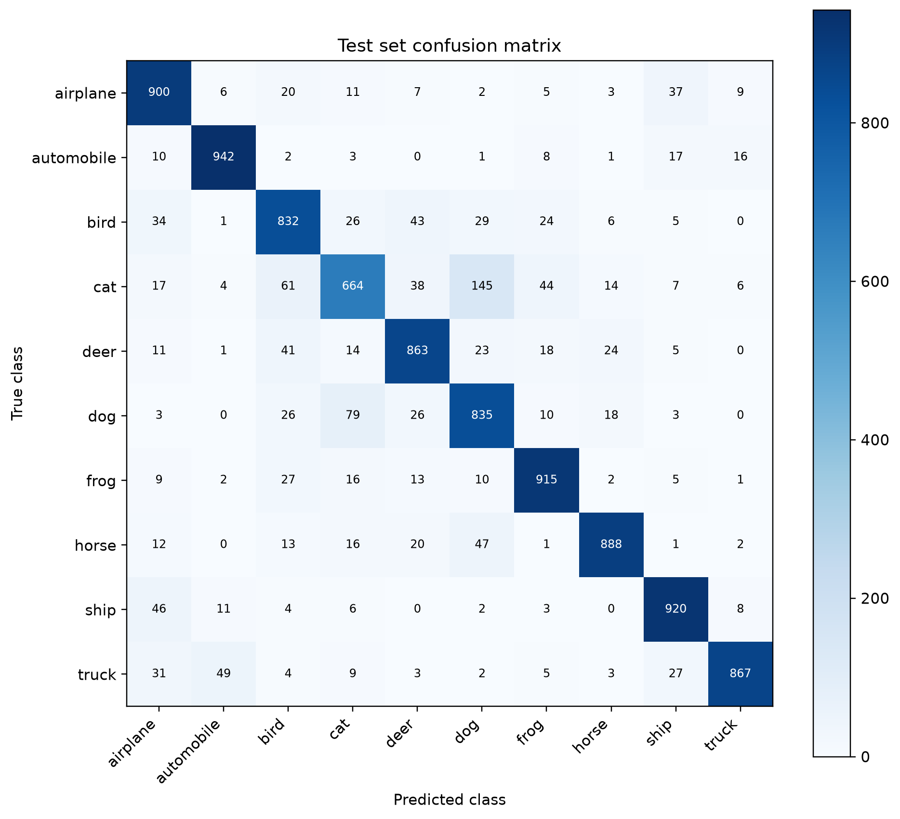
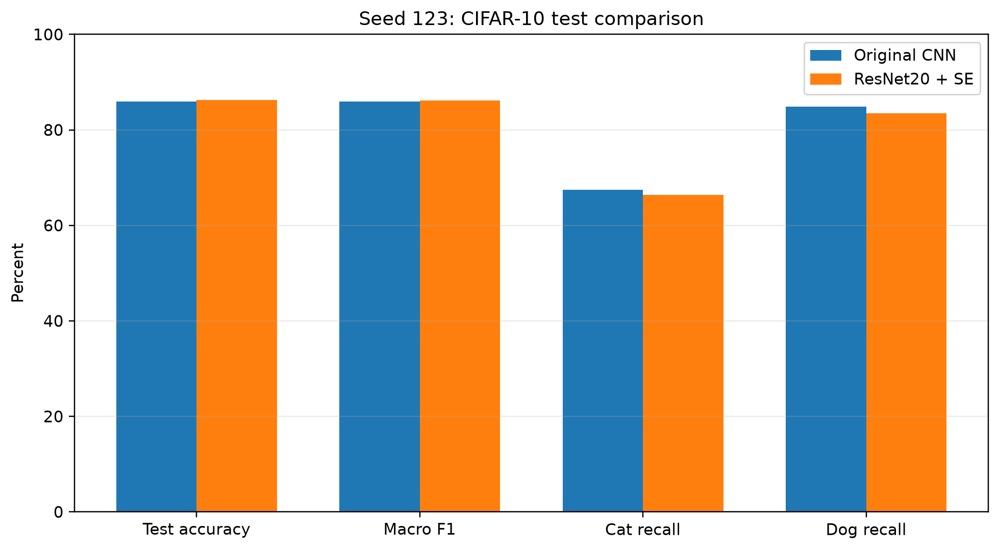
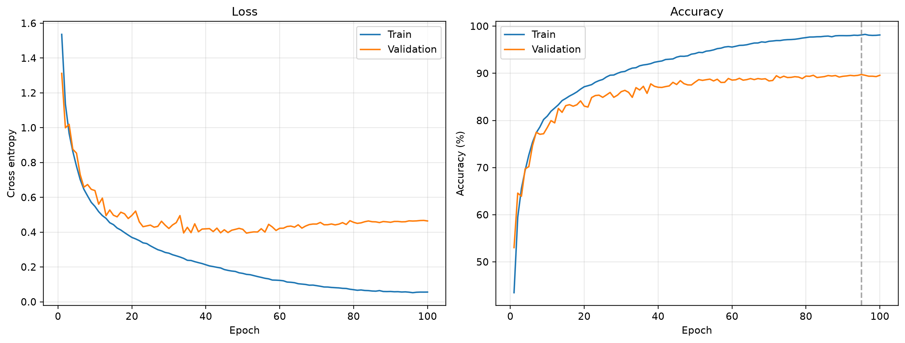
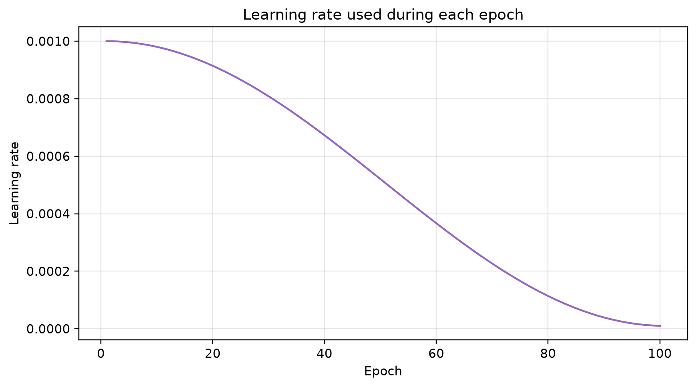
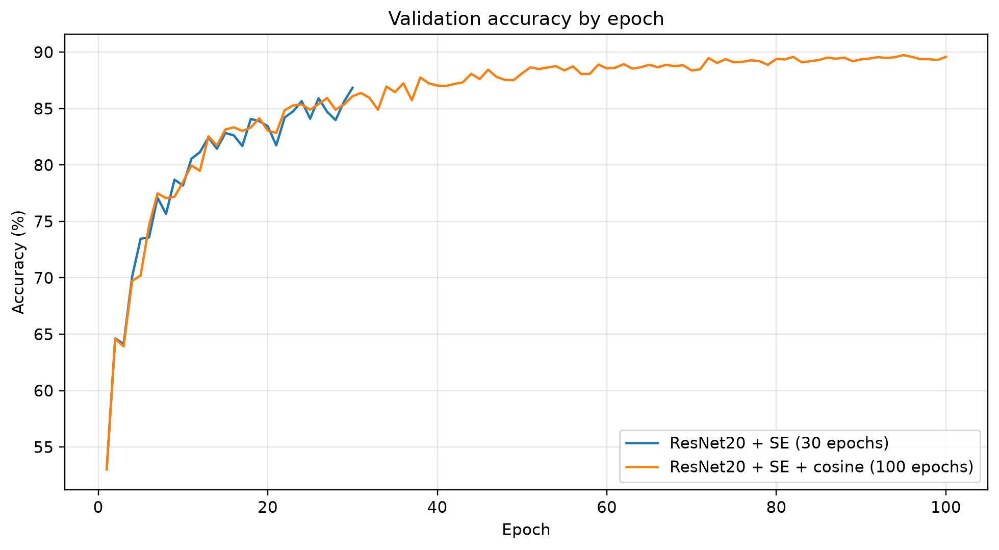
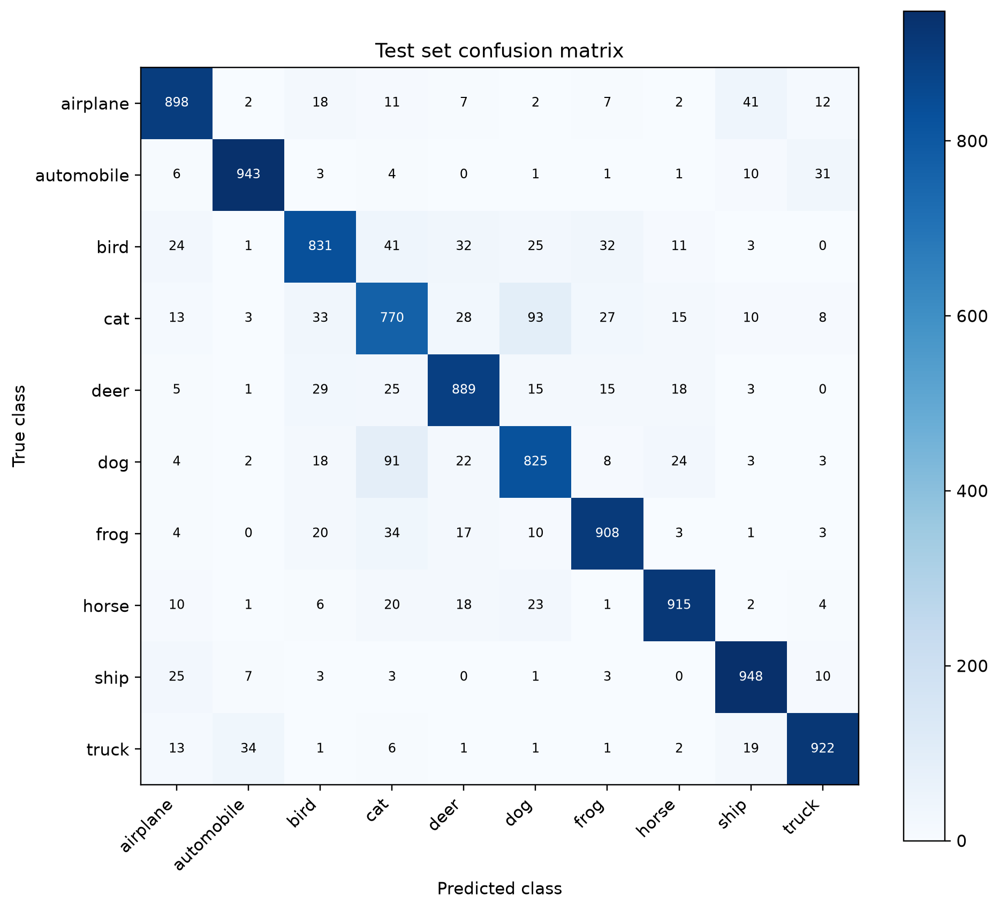
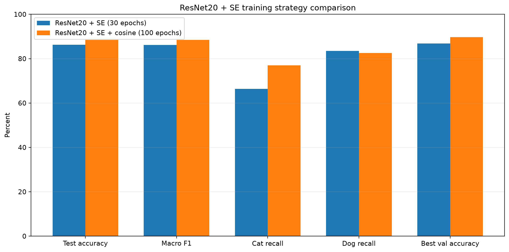
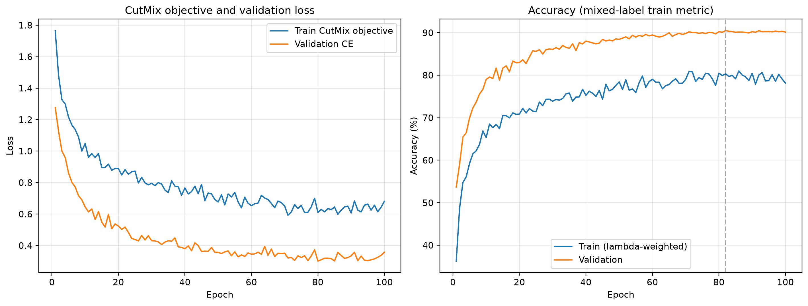
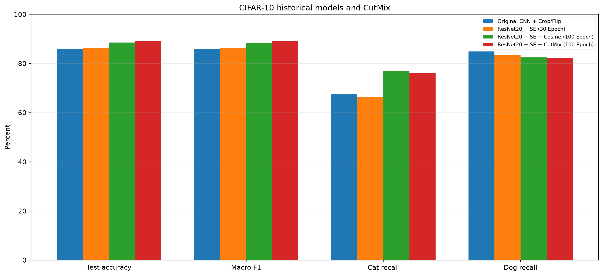

# CIFAR-10 Image Classification Research

基于 PyTorch 的 CIFAR-10 图像分类实验项目，记录 CNN 基线、数据增强消融、模型结构比较和分类错误分析。现有实验与结果均保留，最终训练阶段比较了 ResNet20 + SE、余弦退火和 CutMix。

当前最终模型为 ResNet20 + SE + CutMix（100 Epoch）：测试准确率 89.20%，Macro F1 89.17%，最佳验证准确率 90.48%（Epoch 82），参数量 274,847。完整实验报告见 [CIFAR10_Research_Final_Report.pdf](reports/CIFAR10_Research_Final_Report.pdf)。

## 项目目标

- 建立可复现的 CNN 图像分类基线。
- 比较 Crop + Flip、ColorJitter、Cutout 等数据增强。
- 对比原始 CNN 与 CIFAR 风格 ResNet20 + SE。
- 分析类别召回率、混淆矩阵、Grad-CAM 和遮挡敏感性。

## 环境与依赖

本次实验使用现有 Conda 环境 `cifar10`，运行时实际版本为 Python 3.14.10、PyTorch 2.15.0、TorchVision 0.29.2、Matplotlib 3.11.2；Apple M4 的 MPS 可用。依赖版本记录在 `requirements.txt`，环境信息见 `environment.txt`。

以下命令均从克隆后的仓库根目录运行。已有环境直接激活即可：

```bash
conda activate cifar10
```

新环境可使用项目依赖清单安装：

```bash
python -m pip install -r requirements.txt
```

## 数据集与划分

数据集位于 `data/cifar-10-batches-py/`，训练脚本使用 `download=False`，不会在已有数据上重新下载。若在新机器上数据尚未准备好，可运行数据检查脚本；TorchVision 会在缺少数据时下载 CIFAR-10：

```bash
python -m scripts.explore_data
```

训练和验证使用项目已保存的固定分层索引：45,000 张训练图像、5,000 张验证图像；每类分别为 4,500/500 张。该固定划分由 seed 42 生成，所有模型共用。配置中的 seed 123 用于训练随机过程，不会重新生成数据划分。归一化均值为 `[0.49135084, 0.48206815, 0.44654978]`，标准差为 `[0.24713241, 0.24362119, 0.26172142]`。

每轮实验都只依据验证集选择 checkpoint，再对 10,000 张测试图像做最终评估；测试集不参与梯度更新或 checkpoint 选择。项目多轮实验重复查看了同一个测试集，因此跨轮比较存在一定的研究层面选择偏差，不能把最终单次结果视为独立盲测。

## 项目结构

```text
configs/                    实验配置
data/                       CIFAR-10 原始文件（Git 忽略）
src/train.py                共享训练入口与数据管线
src/models/baseline_cnn.py  原始 CNN
models/resnet20_se.py       ResNet20 + SE
scripts/                    数据审计、评估、对比及错误分析脚本
experiments/                每轮历史、配置、汇总与实验结果
checkpoints/                best/last 权重（Git 忽略）
outputs/metrics/            固定数据索引及历史指标
outputs/figures/            历史实验图表
reports/                    最终综合实验报告
```

## 模型

### 原始 CNN

三个卷积块分别使用 32、64、128 个通道。每块包含两层 3×3 卷积、BatchNorm、ReLU 和 2×2 最大池化；之后使用全局平均池化、Dropout(0.3) 和 10 类线性分类头。参数量为 288,746。

### ResNet20 + SE

采用 CIFAR 风格残差网络：16 通道卷积 stem，随后是 16、32、64 通道的三个 stage，每个 stage 有三个 BasicBlock。降采样块使用 1×1 shortcut；每个残差块在第二个卷积后加入 SE 通道注意力，Reduction Ratio 为 16。网络以全局平均池化和 10 类线性层结束。参数量为 274,847。

SE 对通道响应做自适应重标定。本次结果比较的是“ResNet20 + SE”整体与原 CNN，未单独训练去掉 SE 的 ResNet20，因此不能把性能变化单独归因于 SE。

## 早期训练设置：CNN 与 ResNet20 + SE 30 Epoch

| 设置 | 值 |
|---|---:|
| 训练/验证/测试样本 | 45,000 / 5,000 / 10,000 |
| 数据增强 | RandomCrop(32, padding=4)、RandomHorizontalFlip(p=0.5) |
| Seed | 123（固定已有数据划分不变） |
| 优化器 / 损失 | AdamW / CrossEntropyLoss |
| 学习率 / Weight Decay | 0.001 / 0.0001 |
| Batch Size / Epochs | 128 / 30 |
| 设备 | Apple M4 MPS |

本轮只改变模型架构，没有加入 Cutout、MixUp、CutMix、学习率调度或 EMA。每轮训练/验证损失、准确率和耗时保存在实验目录的 `history.csv`；根据验证准确率保存 `best` checkpoint，并在每个完整 epoch 后更新可恢复的 `last` checkpoint。

## 运行 ResNet20 + SE 30 Epoch 基线

从项目根目录运行：

```bash
conda activate cifar10
python -m src.train --config configs/resnet20_se_seed123.json
```

如进程中断，可使用相同配置从最近完成的 epoch 恢复：

```bash
python -m src.train --config configs/resnet20_se_seed123.json --resume
```

训练结束后，用验证集最佳权重评估测试集，并生成类别指标、混淆矩阵和训练曲线：

```bash
python -m scripts.evaluate_experiment --run resnet20_se_seed123
```

与原 CNN 的 Seed 123 实验生成对比表、JSON/CSV 数据和图表：

```bash
python -m scripts.compare_models
```

新实验产物位于 `experiments/resnet20_se_seed123/`，包括 `config.json`、`history.csv`、`summary.json`、`test_metrics.json`、`class_metrics.csv`、`comparison.*`、`training_curves.png` 和 `confusion_matrix.png`。其他现有分析入口包括 `scripts/analyze_confusion.py`、`scripts/gradcam_errors.py`、`scripts/occlusion_analysis.py` 和 `scripts/multiseed_analysis.py`；这些历史脚本针对各自配置中的原始 CNN 实验。

## 实验结果

对比对象为 `cnn_crop_flip_seed123` 和 `resnet20_se_seed123`，均使用相同数据划分、归一化、Crop + Flip、seed 123、AdamW 和 30 轮训练。原 CNN 的准确率、类别召回和混淆矩阵取自已有测试结果；Macro F1 由已保存的混淆矩阵计算。

| 指标 | 原始 CNN | ResNet20 + SE |
|---|---:|---:|
| 参数量 | 288,746 | 274,847 |
| Test Accuracy | 85.95% | 86.26% |
| Macro Precision | 86.33% | 86.36% |
| Macro Recall | 85.95% | 86.26% |
| Macro F1 | 85.94% | 86.20% |
| Cat Recall | 67.40% | 66.40% |
| Dog Recall | 84.90% | 83.50% |
| 训练耗时 | 9.98 分钟 | 18.91 分钟 |

ResNet20 + SE 的测试准确率提升 0.31 个百分点，Macro F1 提升约 0.25 个百分点；参数量减少约 4.8%，训练时间约为原 CNN 的 1.89 倍。猫和狗召回率分别下降 1.0 和 1.4 个百分点，因此整体准确率的小幅提升没有转化为猫狗识别改善。该实验 checkpoint 根据验证集选择，测试集仅用于完成训练后的指标报告；项目多轮实验共享同一测试集的限制见上文。

最佳验证准确率为 86.84%（第 30 轮）。最终训练准确率为 90.05%，验证准确率为 86.84%，相差 3.21 个百分点；训练与验证曲线有差距，但验证准确率和验证损失到最后一轮仍达到本轮最佳，未观察到明确的末期验证退化。SE 可能改善通道特征选择，但由于没有“相同 ResNet20、去掉 SE”的消融实验，本轮不能独立确认 SE 的贡献。多随机种子结果可进一步检验这 0.31 个百分点的提升是否稳定。

### 训练曲线



### 测试集混淆矩阵



### Seed 123 模型对比



## ResNet20 + SE：100 Epoch Cosine Annealing

本轮保持模型、随机初始化 seed、固定数据划分、归一化和 Crop + Flip 不变，从头训练 100 Epoch。唯一计划中的训练策略配置为 AdamW（初始 LR 0.001、Weight Decay 0.0001）和 `CosineAnnealingLR(T_max=100, eta_min=0.00001)`；不使用 warmup、EMA 或 early stopping。scheduler 在每轮训练和验证结束后 step 一次。CSV 中记录的是该轮实际使用的 LR：第 1 轮为 0.001，第 100 轮为 0.000010244；第 100 轮结束 step 后到达 `eta_min=0.00001`。

复现实验、从 last checkpoint 恢复、评估和生成对比文件：

```bash
conda activate cifar10
python -m src.train --config configs/resnet20_se_cosine_100_seed123.json
python -m src.train --config configs/resnet20_se_cosine_100_seed123.json --resume
python -m scripts.evaluate_experiment --run resnet20_se_cosine_100_seed123
python -m scripts.compare_resnet20_training
```

`--resume` 用于中断后的恢复，会恢复模型、AdamW、CosineAnnealingLR、Python/Torch/MPS/DataLoader RNG 状态。模型参数量仍为 274,847。完整逐轮记录、配置、summary、测试指标、类别指标和 checkpoint 位于 `experiments/resnet20_se_cosine_100_seed123/` 与 `checkpoints/`；权重文件由 `.gitignore` 忽略。

### 30 Epoch 与 100 Epoch 对比

| 指标 | ResNet20 + SE（30 Epoch） | ResNet20 + SE + Cosine（100 Epoch） |
|---|---:|---:|
| Test Accuracy | 86.26% | 88.49% |
| Macro F1 | 86.20% | 88.48% |
| Cat Recall | 66.40% | 77.00% |
| Dog Recall | 83.50% | 82.50% |
| Best Val Accuracy | 86.84%（Epoch 30） | 89.74%（Epoch 95） |
| Training Time | 18.91 分钟 | 65.78 分钟 |

100 Epoch 方案的测试准确率提高 2.23 个百分点，Macro F1 提高 2.28 个百分点，猫召回率提高 10.60 个百分点；狗召回率下降 1.00 个百分点。训练时间约为 30 Epoch 的 3.48 倍。两次实验同时改变了 epoch 数和学习率调度，因此不能把提升单独归因于 Cosine Annealing；需要固定 LR 的 100 Epoch 对照组才能分辨调度贡献。

### 100 Epoch 最终测试指标

最佳验证 checkpoint 为 Epoch 95。测试集准确率为 88.49%，Macro Precision 为 88.49%，Macro Recall 为 88.49%，Macro F1 为 88.48%。每类 Precision、Recall、F1 见 [class_metrics.csv](experiments/resnet20_se_cosine_100_seed123/class_metrics.csv)，完整混淆矩阵和测试结果见 `test_metrics.json`。

训练准确率最后为 98.13%，验证准确率最后为 89.58%，相差 8.55 个百分点；验证准确率最高为 89.74%（Epoch 95），最后一轮回落 0.16 个百分点。验证损失最低为 0.3946（Epoch 51），最后升至 0.4643。训练准确率继续上升而验证损失后期较早回升，显示出过拟合迹象；最佳验证 checkpoint 的测试准确率仍达到 88.49%。测试集没有参与 checkpoint 选择。

### 训练、验证与学习率曲线







### 测试混淆矩阵与策略对比





## ResNet20 + SE：CutMix（100 Epoch）

本实验从随机初始化开始训练 ResNet20 + SE，并沿用固定的 45,000/5,000/10,000 划分、归一化、Crop + Flip、AdamW 和 100 Epoch Cosine Annealing。唯一新增的方法是 CutMix：每个训练 batch 以 0.5 概率采样 `Beta(1, 1)`，按采样值生成矩形区域并从 batch 中另一张图像粘贴；随后按实际矩形面积重算 λ，并用 `λ × CE(y_a) + (1 − λ) × CE(y_b)` 计算损失。未触发 CutMix 时使用普通 Cross Entropy。验证和测试阶段均不使用 CutMix。

| 设置 | 值 |
|---|---:|
| 模型 / 参数量 | ResNet20 + SE / 274,847 |
| Seed / Epochs / Batch Size | 123 / 100 / 128 |
| Optimizer / Weight Decay | AdamW / 0.0001 |
| 初始 / 最小学习率 | 0.001 / 0.00001 |
| Scheduler | CosineAnnealingLR，T_max=100 |
| CutMix alpha / 概率 | 1.0 / 0.5 |
| 设备 | Apple M4 MPS |

复现、恢复中断的训练、评估和生成四组模型对比：

```bash
conda activate cifar10
python -m scripts.validate_cutmix
python -m src.train --config configs/resnet20_se_cutmix_100_seed123.json
python -m src.train --config configs/resnet20_se_cutmix_100_seed123.json --resume
python -m scripts.evaluate_experiment --run resnet20_se_cutmix_100_seed123
python -m scripts.compare_cutmix
```

`history.csv` 中的训练准确率是按实际 λ 加权的双标签正确率，训练损失是 CutMix 双标签目标；两者不能直接等同于普通单标签训练准确率和验证交叉熵。配置、逐轮 history、summary、最终测试指标和类别指标保存在 `experiments/resnet20_se_cutmix_100_seed123/`。可恢复的 `last` checkpoint 和按验证准确率选出的 `best` checkpoint 位于 `checkpoints/`，包含优化器、scheduler 和随机数状态。

最终权重保存在本地 `checkpoints/resnet20_se_cutmix_100_seed123_best.pth`，由 `.gitignore` 排除，不随 GitHub 仓库分发；实验配置、训练记录、测试指标、类别指标与图表保留在 `experiments/resnet20_se_cutmix_100_seed123/`。

### 与历史实验的结果比较

| 模型 | 参数量 | Test Accuracy | Macro F1 | Cat Recall | Dog Recall | Best Val Accuracy | 训练时间 |
|---|---:|---:|---:|---:|---:|---:|---:|
| Original CNN + Crop/Flip | 288,746 | 85.95% | 85.94% | 67.40% | 84.90% | 86.76%（Epoch 25） | 9.98 分钟 |
| ResNet20 + SE（30 Epoch） | 274,847 | 86.26% | 86.20% | 66.40% | 83.50% | 86.84%（Epoch 30） | 18.91 分钟 |
| ResNet20 + SE + Cosine（100 Epoch） | 274,847 | 88.49% | 88.48% | 77.00% | 82.50% | 89.74%（Epoch 95） | 65.78 分钟 |
| ResNet20 + SE + CutMix（100 Epoch） | 274,847 | **89.20%** | **89.17%** | 76.10% | 82.40% | **90.48%（Epoch 82）** | 64.34 分钟 |

CutMix 本轮测试准确率超过 89%，相较 100 Epoch Cosine 基线提升 0.71 个百分点，Macro F1 提高约 0.69 个百分点；最佳验证准确率提高 0.74 个百分点。猫召回率下降 0.90 个百分点，狗召回率下降 0.10 个百分点，因此整体提升没有转化为猫狗类别召回提升。训练用时与基线相近（64.34 对 65.78 分钟）；本次单次运行没有看到明显的额外耗时或验证指标收敛变慢，CutMix 在第 71 Epoch 首次达到 90% 验证准确率，Cosine 基线在 100 Epoch 内未达到 90%。单次运行时间会受设备负载影响，不代表稳定的速度优势。

最佳验证准确率出现在 Epoch 82；最后一轮验证准确率为 90.16%，比峰值低 0.32 个百分点。验证损失在 Epoch 80 最低（0.3005），到 Epoch 100 为 0.3571，说明末段有轻微验证退化。训练准确率采用 CutMix 标签加权口径，不能和普通验证准确率直接比较，也不能用二者差值判断过拟合。测试集在训练和选模完成后用于最终指标报告。本项目多轮实验均查看过同一测试集，因此跨轮最佳结果可能存在研究层面的选择偏差；单个 seed 也不足以说明 CutMix 收益稳定。

逐类别 Precision、Recall、F1 见 [class_metrics.csv](experiments/resnet20_se_cutmix_100_seed123/class_metrics.csv)，全量数值和混淆矩阵见 [test_metrics.json](experiments/resnet20_se_cutmix_100_seed123/test_metrics.json)。四组模型的对比数据另存为 [comparison.md](experiments/resnet20_se_cutmix_100_seed123/comparison.md)、CSV 和 JSON。

### CutMix 训练曲线与学习率




### CutMix 测试结果




## 后续方向

本项目当前训练阶段已结束，不再为追求更高的单次准确率而延长训练。若后续开展独立研究，可用多个随机种子检验 CutMix 收益、增加不含 SE 的 ResNet20 控制组，或用固定学习率 100 Epoch 对照单独研究余弦退火；这些实验不属于当前结论。
